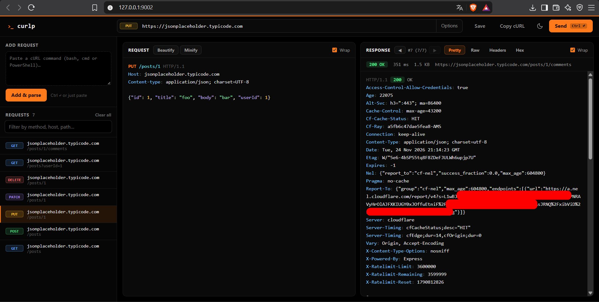

# curlp

A small HTTP request workbench in the spirit of Burp Repeater. Paste any cURL command, edit the raw request, replay it as often as you like and read the response in colour. Standard library only, single binary, UI embedded.



## Run

```bash
go run ./cmd/curlp             # or: go run cmd/curlp/main.go
go build -o bin/curlp ./cmd/curlp
go test ./...
```

Flags: `-port 9002` (always bound to 127.0.0.1), `-no-open` (do not open the browser).

## Use

1. Paste a cURL command into **Add request** in the sidebar (Ctrl+Enter, the *Add & parse* button, or simply paste). It is parsed, added to the list and loaded into the editor.
2. Edit the raw request. The **Target** field decides where it is sent; the `Host` header is sent as written.
3. **Ctrl+Enter** sends, from anywhere. Press it again and again: every press fires a new request and gets its own entry in the response history (◀ ▶ walk through requests and responses).
4. **Save** updates the selected request (or creates one). **Copy cURL** turns the current request back into a command.

Supported commands: bash/zsh (Chrome, Firefox, Burp "Copy as cURL"), Windows cmd (`^` escapes) and PowerShell (`curl.exe`, backticks). Options: `-X -H -d/--data* --data-urlencode --json -F -u --oauth2-bearer -b -A -e -G -I -k -L -m --url`, short-flag clusters such as `-sSLk`, attached values such as `-XPOST`. Options that cannot be replayed (`-x`, `--cert`, `@file` references…) produce a warning instead of being dropped silently.

## Layout

```
cmd/curlp/            entry point (main.go)
internal/curl/        cURL command parser (bash, cmd, PowerShell)
internal/request/     raw HTTP text: parse, build, resolve URL, to-cURL
internal/server/      HTTP API, local-only guard, saved list, request sender
web/                  embedded UI (web/static: index.html, style.css, app.js)
```

## Security

- Listens on 127.0.0.1 only; the Host header, the Origin header and a custom `X-Curlp` header are checked, so other web pages cannot make your machine send requests (CSRF / DNS rebinding).
- The saved list lives in memory only. Requests often contain tokens and cookies, so nothing is written to disk.
- "Ignore TLS errors" is on by default (like the old Bytar curl parser). Turn it off under **Options** when it matters.
- Responses are cut at 10 MB.
